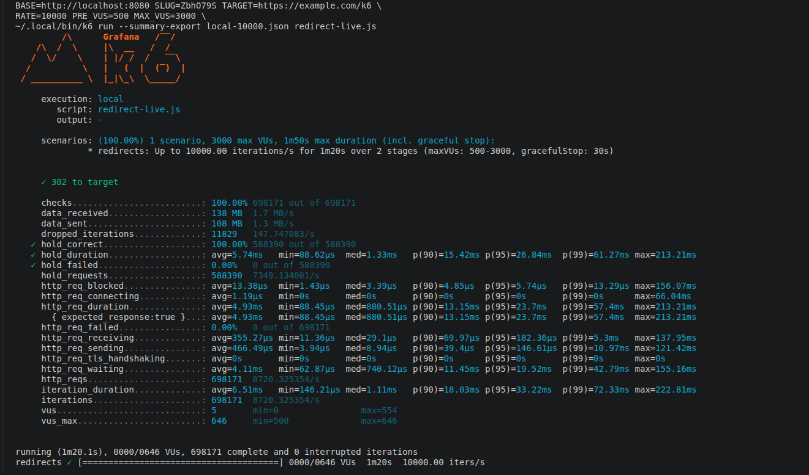

# shortened.cv

**Short links. Less nonsense.**

A URL shortener built with Go, PostgreSQL, Redis, and Nuxt. Shorten a URL without signing up, claim
it later, and understand its traffic through a simple analytics dashboard. Underneath the interface
are a two-level redirect cache, an asynchronous click pipeline, and a set of reproducible load and
failure tests.

[Web app](https://app.shortened.cv) · [Short-link domain](https://shortened.cv) ·
[Technical write-up](WRITEUP.md) · [Benchmark evidence](k6-benchmarks/README.md)

## Features

- **Instant shortening:** create links without an account; claim anonymous links after signing in.
- **Accounts and link management:** email magic links, optional Google OAuth, saved links, search,
  and deletion.
- **Custom slugs and previews:** signed-in users choose a slug of up to 128 characters, or rename a
  link later from the dashboard; old slugs keep redirecting and share the link's stats. Inspect a
  destination at `/{slug}+` without registering a click.
- **Analytics:** dashboard and API for human clicks, approximate unique visitors, bot visits, daily
  trends, referrers, traffic sources, devices, browsers, locations (when configured), and UTM
  campaigns.
- **Fast redirects:** in-process LRU cache, optional Redis L2 cache, coalesced cache misses, and
  bounded database lookups.
- **Resilient ingestion:** Redis Streams, batched PostgreSQL writes, idempotent event IDs, and an
  in-memory fallback when Redis is unavailable.
- **Operations and safety:** anonymous rate limits, cross-instance cache invalidation, admin
  takedowns, optional Google Web Risk checks, health endpoints, and Prometheus metrics.

## Architecture

```
                       ┌── L1: Go in-memory LRU
Visitor ──▶ Go / Gin ──┤         │ cache miss
             │         └── L2: Redis cache
             │                   │ cache miss
             │                   ▼
             │               PostgreSQL
             │
             ├──▶ HTTP 302 → destination
             │
             └──▶ click buffer ──▶ Redis Stream ──▶ consumers ──▶ PostgreSQL
                        │
                        └── Redis unavailable or over budget ──▶ memory writer ──▶ PostgreSQL
```

The API uses 302 redirects rather than browser-cacheable permanent redirects, so later visits can
still be recorded. Cached slugs are checked for expiry, and deletion or takedown invalidates cached
destinations. Concurrent misses for a slug share one lookup instead of each querying PostgreSQL.

Click events are queued without making the visitor wait for a database write. Redis Stream consumers
write batches to PostgreSQL, and per-event IDs prevent double counting on retries. The memory
fallback favors continued redirects over perfect click durability: events not yet persisted can be
lost on a process crash or buffer overflow.

PostgreSQL stores daily-partitioned raw clicks and precomputed daily rollups. Raw events are kept
for 30 days by default. Click records hold no raw IP addresses or full referrer URLs, and unique
visitors are approximated with a keyed hash that rotates daily.

For the design decisions and failure handling, read [Building shortened.cv](WRITEUP.md).

## Benchmarks

The repository includes the [test harnesses, environment manifests, and recorded results](k6-benchmarks/README.md).
These are short synthetic measurements, not availability or maximum-capacity guarantees.

### Local mixed workload · September 29, 2026

One Go API instance, PostgreSQL 17, Redis 7.2, and k6 on the same 16 GB laptop. The API container
was limited to 2 CPUs and 512 MiB, PostgreSQL to 2 CPUs and 1 GiB, and Redis to 0.5 CPU and
256 MiB. Requests used plain HTTP over Docker networking.

| Offered workload | Duration | Delivered redirects/s | Redirect p99 | Outcome |
|---|---|---|---|---|
| 1,000 redirects + 50 creations + 10 reports/s | 120 s | ~1,000 | 1.3 ms | Passed |
| 3,200 redirects + 100 creations + 10 reports/s | 60 s | ~3,200 | 7.9 ms | Passed |
| 5,000 redirects + 100 creations + 10 reports/s | 30 s | ~4,963 | 52.6 ms | Missed 1,023 scheduled redirects |
| 5,000 redirects/s to one hot link | 30 s | ~5,000 | 14.2 ms | Passed |

The 3,200 redirects/s run had no HTTP errors, incorrect responses, or dropped iterations. After the
click queue drained, all 192,000 events were reconciled with PostgreSQL, including 19,200 bot
requests, and all 6,001 created links were accounted for. Results:
[load data](k6-benchmarks/2026-09-29-local/load-results.json) and
[environment](k6-benchmarks/2026-09-29-local/environment.json).

### Live VPS through HTTPS and Traefik · October 12, 2026

The deployment runs on a 4 vCPU, 7.8 GiB Contabo VPS shared with other applications. k6 ran on the
same VPS. Each step ramped for 20 seconds, then aimed to hold the target rate for 60 seconds. Every
request targeted one warm-cached link over TLS keep-alive connections.

| Target redirects/s | Delivered during hold | p95 / p99 | Outcome |
|---|---|---|---|
| 1,000 | ~1,000/s | 13.8 / 39.6 ms | No HTTP errors or incorrect responses |
| 2,000 | ~1,978/s | 68.1 / 151.6 ms | No HTTP errors; 462 dropped iterations across ramp and hold |
| 3,000 | Not sustained | — | Stopped as the shared host saturated and latency rose into seconds |

These numbers measure Traefik, TLS, the API, and an on-host load generator together; they don't
isolate the Go server. The harness used for this run started its warm-up clock per k6 virtual user,
so the hold-window figures are approximate. The [script](k6-benchmarks/2026-10-12-production/scripts/redirect-live.js)
now times the warm-up from the scenario start. Click persistence was not reconciled after each step.
See the [results and caveats](k6-benchmarks/README.md) and the
[k6 summaries](k6-benchmarks/2026-10-12-production/run2-1000-to-3000/).

## Run the k6 tests

Docker Compose provides a separate test database, Redis, and API. From the repository root:

```sh
cd server/k6
docker compose up -d --build --wait
docker compose exec -T db psql -U postgres -d k6 < seed.sql
docker compose run --rm k6 run smoke.js
docker compose run --rm k6 run mixed.js
```

Choose `health.js`, `redirects.js`, `create.js`, `stats.js`, or `mixed.js` for load tests.
`smoke.js` checks API behavior; `clicks.js` verifies that a known number of visits are stored.

```sh
# 1,000 redirects/s for one minute
docker compose run --rm -e RATE=1000 -e DURATION=1m k6 run redirects.js

# Remove the test stack and its data when finished
docker compose down -v
```

See the [k6 guide](server/k6/README.md) for settings, larger analytics datasets, recovery checks,
and testing another deployment. [Recorded results](k6-benchmarks/README.md) include the exact
conditions and limitations of earlier runs.



The October 14 run delivered about 9,800 redirects/s to one cached link on one laptop, with k6
sharing the machine. All 698,171 clicks, including warm-up, were stored. See the
[results and environment](k6-benchmarks/README.md#2026-10-14-local-one-link-no-limits).

## Stack

| Area | Technologies |
|---|---|
| Backend | Go, Gin |
| Frontend | Nuxt 4, Vue, Nuxt UI, TanStack Query |
| Database | PostgreSQL 17, sqlc, goose migrations |
| Cache and event delivery | In-process LRU, Redis, Redis Streams |
| Authentication | limen, email magic links, Google OAuth |
| Observability and testing | Prometheus, pprof, Go tests, k6 |
| Deployment | Docker Compose, Coolify, Traefik |

## Run locally

Requirements: Go 1.26+, Bun, and Docker Compose. `sqlc` and the `goose` CLI are optional; the API
applies its embedded migrations at startup by default.

### 1. Start PostgreSQL, Redis, and the API

```sh
git clone https://github.com/IbrahimIjai/sh.sh.git
cd sh.sh/server
cp .env.example .env

# Set LIMEN_SECRET in .env to exactly 32 characters: openssl rand -hex 16
# To enable the Redis cache and click stream, also set REDIS_URL=redis://localhost:6380/0

docker compose up -d db redis
set -a; . ./.env; set +a
go run ./cmd/api
```

The API listens on `http://localhost:8080`. `GET /health` checks liveness and `GET /health/ready`
checks the database. Without an email provider, magic links are printed to the API log. Google
sign-in needs OAuth credentials.

### 2. Start the Nuxt app

```sh
# In another terminal, from sh.sh/
cd ui
bun install
bun run dev
```

Open `http://localhost:3000`. The app calls `http://localhost:8080` by default; override it with
`NUXT_PUBLIC_API_BASE`.

### 3. Create a short link

```sh
curl -X POST http://localhost:8080/api/v1/links \
  -H 'Content-Type: application/json' \
  -d '{"target_url":"https://example.com/a/long/path"}'
```

The response includes `short_url` and, for anonymous links, a one-time `claim_token`.

## API overview

| Endpoint | Purpose |
|---|---|
| `POST /api/v1/links` | Create a link, signed in or anonymous |
| `POST /api/v1/links/lookup` | Read anonymous links by claim token |
| `POST /api/v1/links/claim` | Claim anonymous links after signing in |
| `GET /api/v1/links` | List your links |
| `GET /api/v1/links/:id/stats?days=30` | Analytics for one of your links |
| `PATCH /api/v1/links/:id` | Rename one of your links; old slugs keep working |
| `DELETE /api/v1/links/:id` | Soft-delete one of your links |
| `GET /{slug}` | Redirect with HTTP 302 |
| `GET /{slug}+` | Preview the destination |

The backend also has domain management, authentication, and optional admin takedown endpoints. See
the [server documentation](server/README.md).

## Tests

```sh
# Backend unit tests (from server/)
go test -race ./...

# Frontend checks (from ui/)
bun run lint
bun run typecheck

# API checks from the repository root (after starting the test stack above)
docker compose -f server/k6/compose.yml run --rm k6 run smoke.js
```

PostgreSQL and Redis integration tests are covered in the [server README](server/README.md).
API behavior and load tests are documented in the [k6 guide](server/k6/README.md).

## Repository layout

```
sh.sh/
├── server/         Go API, queries, migrations, tests, k6 load tests
├── ui/             Nuxt frontend and analytics dashboard
├── k6-benchmarks/  Published local and live-VPS results
├── WRITEUP.md      Architecture and engineering notes
└── README.md
```

## Deploying

For an internet-facing deployment, set `APP_ENV=production` (secure auth cookies, no development
CLI), trusted proxy settings, email delivery, TLS, fresh secrets, monitoring, and a tested backup
and restore. Keep the internal metrics and pprof listener private. See the
[server configuration guide](server/README.md) before deploying.

---

Built by [Ibrahim Ijai](https://iamibrahim.xyz) · [X](https://x.com/ibrahimijai) ·
[GitHub](https://github.com/IbrahimIjai)
